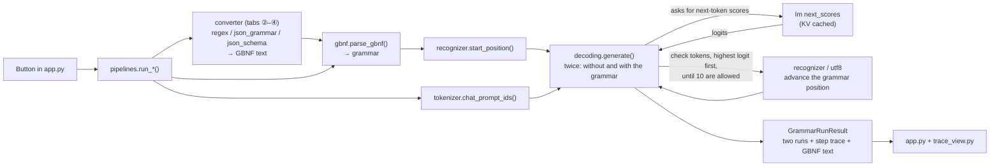

# Grammar-Constrained Explorer

An interactive Streamlit app for **seeing** how a formal grammar limits which tokens a language
model may write, step by step. It runs a small open model (Qwen2.5) on your laptop, so you can
see at every step which tokens the grammar allowed, which it disallowed, and why.

It's a companion to the *Grammar* examples in
[Generative AI Design Patterns](https://github.com/lakshmanok/generative-ai-design-patterns)
(`examples/02_grammar`), covering notebooks 1, 2a and 2b. It's also the sequel to
logits-masking-explorer: grammar-constrained decoding is logits masking where a grammar decides
what to mask.

> **New to this?** Read [docs/how-grammar-constraints-work.md](docs/how-grammar-constraints-work.md)
> first. It explains the ideas in plain language with diagrams and real examples from this app.
> Terms are defined in [GLOSSARY.md](GLOSSARY.md); design decisions live in [docs/adr/](docs/adr/).

---

## Quick start

Requirements: [uv](https://docs.astral.sh/uv/), about 2 GB of free RAM, and an internet connection
for the first run (to download the model, about 1 GB, from Hugging Face).

```bash
uv sync                          # installs Python 3.12 + dependencies into .venv
uv run streamlit run app.py      # opens http://localhost:8501
```

The first page load downloads and loads the model (around 10 to 20 seconds once downloaded).
After that, each click takes roughly 5 to 30 seconds on a laptop CPU: every button generates
twice, once without and once with the grammar, and the constrained run checks tokens one by one.

Run the tests (no model download needed; they use a fake tokenizer and a fake model):

```bash
uv run pytest
```

### Configuration

| Setting | How | Default |
|---|---|---|
| Model | Sidebar dropdown | `Qwen/Qwen2.5-0.5B-Instruct` (also offers `1.5B`, which writes better but is ~3x slower) |
| Device | `GCE_DEVICE=mps uv run streamlit run app.py` (or `cuda`, `cpu`) | `cpu` (or `cuda` if available) |

> **Why not Apple's MPS by default?** Recent PyTorch builds can crash on MPS on older macOS
> versions. The 0.5B model is fast enough on CPU. On a recent macOS you can try `GCE_DEVICE=mps`.

The presets were checked against the 0.5B model (see
[Differences from the reference notebooks](#differences-from-the-reference-notebooks)). The 1.5B
model gives different, usually better, outputs, so some lessons may look different with it.

---

## How the app works

The app has four tabs, meant to be followed in order. Each one adds one idea to the last, and
all four use the same grammar engine: a regex, "any JSON" and a schema are each turned into a
grammar first.

Every tab has the same layout: a **preset** (taken from the notebooks), an **input** to choose
and edit, the system prompt in an expander, a **Generate both runs** button, and at the bottom the
notebook's own code as a read-only snippet.

Every click produces the same kind of result:

- the **unconstrained run** (no grammar) next to the **grammar-constrained** run, with
  ✅ *complete* (the output fully matches the root rule and the model stopped by itself) or
  ⚠️ *incomplete output* (it hit the token limit, even if the output so far happens to match);
- a **step trace** of the constrained run:
  - buttons for the steps where the mask changed the model's top choice (click one to jump there);
  - a step slider;
  - the top 10 tokens **before the mask** (disallowed ones marked 🚫);
  - the top 10 **allowed** tokens after it (renormalised);
  - the **grammar position** (open rules and what may come next);
  - "checked N tokens: M disallowed";
  - an **Exact count** button that checks the whole vocabulary at that step.

Tokens are shown with visible whitespace: `␣` is a space and `⏎` a newline.

### ① Grammar-constrained generation

**What it shows:** a grammar written in GBNF deciding, token by token, what the model may write.

**You provide:** a preset, an input, the grammar (editable), the root rule (defaults to the
preset's), and a maximum number of new tokens (default 64).

| Preset | Inputs | Lesson |
|---|---|---|
| **Arithmetic expression** | *Total apples*, *More apples than oranges?* | A valid equation (`3 +2 = 5`), and a **grammar that's too strict**: the comparison needs `>`, which the grammar doesn't have, so the model writes a meaningless equation. |
| **Arithmetic expression (notebook grammar: newline after every line)** | the same two | The notebook's grammar needs a newline after every line, so the model can't stop where it wants to and loops to ⚠️ incomplete output. |
| **Book record (author \| title \| year)** | *Cholera*, *Tirukkural* | **Accents stripped**: `[a-zA-Z ]` disallows `í` and `á`, so "García Márquez" comes out as "Garcia Marez". `NULL` when the year isn't known. |

**What happens when you click *Generate both runs*:**

1. The grammar is parsed (`grammar_lab/gbnf.py`). A mistake such as an undefined rule, `{m,n}` or
   a left-recursive rule is shown inline with its line, a caret and a hint, and nothing is run.
2. The system prompt and input are formatted with Qwen's chat template (`grammar_lab/lm.py`).
3. The model generates **twice** with greedy decoding (`grammar_lab/decoding.py`), each with a
   fresh KV cache:
   - **unconstrained:** the top token every time, until end-of-sequence or the token limit;
   - **constrained:** at every step, tokens are checked from the highest logit down against the
     grammar (`grammar_lab/recognizer.py`) until 10 allowed tokens are found, and the first one is
     chosen. A first-character pre-filter skips tokens whose first character can't come next.
     End-of-sequence is allowed only once the output fully matches the root rule. Generation stops
     at end-of-sequence, when the grammar is complete and nothing more can follow, or at the token
     limit.
4. Every constrained step is recorded for the step trace.

**What you see:** both outputs, the status, and the step trace. Start at the first step where the
mask changed the top choice: for *Cholera*, step 2 shows ` García` at 99.7% marked 🚫 and
` Garcia` chosen.

### ② Regex constraint

**What it shows:** a regex constraint is a grammar too.

**You provide:** the book-record regex from the notebook's Outlines example (editable), an input
(*Cholera* or *Tirukkural*), and a maximum number of new tokens.

**As you edit the regex** (no click needed): it is converted into a GBNF grammar with one rule,
`root` (`grammar_lab/regex.py`), shown next to the regex. Anchors, lookarounds and backreferences
are rejected with a clear error in its place, and *Generate both runs* is disabled until it's fixed.

**What happens when you click *Generate both runs*:** from there it's exactly tab ①: the same two
runs and the same engine.

**What you see:** the **generated grammar (GBNF)** next to the regex, then the same results and
step trace as tab ①. The regex puts a space on both sides of `|`, so the year is written as
` 1985` rather than tab ①'s `|1985`. On *Tirukkural* that one space changes the answer: Qwen
writes the space, then wants `5` or `4` ("5th century", "450"), which the year's `[1-2]` disallows,
so it writes `| 2000`, a year that isn't in the text, where tab ① gave `|NULL`.

### ③ JSON mode

**What it shows:** JSON mode is a grammar that allows **any** JSON object. The output always
parses, but the grammar doesn't control which keys appear or what type each value has.

**You provide:** a preset (*Book record as JSON*, from notebook 2a, or *Book record as JSON, keys
not named*), an input, a **Limit whitespace** toggle (on by default) and a maximum number of new
tokens (default 96).

**What happens when you click *Generate both runs*:** the JSON grammar
(`grammar_lab/json_grammar.py`, shown in an expander) is used exactly as in tab ①. With
**Limit whitespace** on, each gap between JSON tokens allows at most one space, or one newline
plus up to 12 spaces of indent; off, any amount.

**What you see:**

- The unconstrained run wraps its JSON in a ```` ```json ```` fence; the constrained run can't
  (step 0: the backticks are 🚫, only `{` can start the output).
- Accents survive, because JSON strings allow any character.
- **Value types aren't controlled:** on *Tirukkural* Qwen writes `"year": "450-500 CE"`, a string.
- **Keys aren't controlled:** with the second preset, whose prompt doesn't name the keys, it writes
  `publication_year` instead of `year`.

> **About the whitespace loop.** In the smoke test, Qwen 0.5B never fell into a whitespace loop
> in JSON mode, with the limit on or off. A loop needs the model to *want* a disallowed token
> where whitespace is allowed, and "any JSON object" rarely forces anything. Tab ④ has the real
> loop.

### ④ Structured output

**What it shows:** structured output is a grammar built from a schema. The keys are spelled out
in schema order, each value must have its field's type, and an enum allows only its listed values.

**You provide:** the `Invoice` JSON Schema from notebook 2b (editable; supports object, string,
number, integer, boolean, enum, required and nested objects), an input (*Taxi ($32.30)*,
*Clients (€43)* or *Dinner (₹820)*), a **Limit whitespace** toggle and a maximum number of new
tokens (default 64).

**As you edit the schema** (no click needed): the **Python dataclass view** (read-only, the shape of
the notebook's `Invoice` dataclass) and the **generated grammar (GBNF)** update, or a schema error
is shown with its location (`grammar_lab/json_schema.py`).

**What happens when you click *Generate both runs*:** the schema is converted to GBNF and decoded
exactly as in tab ①. Every field is required and in schema order, even `currency`, which has a
default (the callout explains why).

**What you see:**

- The currency is inferred from the input (`USD`, `EUR`, `INR`) although the prompt never
  mentions it; the enum allows nothing else.
- **A real whitespace loop:** on *Clients (€43)* and *Dinner (₹820)*, Qwen wants to close the
  object right after `amount` (`}` at 99.9%), but `}` is disallowed until `currency` is written.
  With the limit on, it uses up the 12 allowed spaces (hence `43⏎␣␣␣␣␣␣␣␣␣␣␣␣,`) and is pushed on
  to `currency`. With the limit off, it writes newlines until the token limit: ⚠️ incomplete output.

---

## Project structure

```
app.py                      Streamlit UI (4 tabs). The only file that knows about Streamlit.
trace_view.py               The step trace component, shared by all four tabs.
grammar_lab/
  lm.py                     Loads the model; tokenizer view; KV-cached next-token scores. The only file that touches torch.
  model_boundary.py         The interface everything else uses: a TokenizerView and start(prompt) -> next_scores.
  pipelines.py              One entry point per tab (run_grammar, run_regex, run_json_mode, run_structured), live
                            previews for tabs ②–④ (preview_regex, preview_json_mode, preview_schema). The UI's only door into grammar_lab.
  gbnf.py                   Parses GBNF-subset text into a grammar, with located error messages.
  recognizer.py             Character-level incremental recognizer: valid prefix? complete? what comes next?
  utf8.py                   Checks byte-level tokens (which can hold part of a character) against the grammar.
  decoding.py               Greedy loop with and without a grammar; records each step; exact counts.
  regex.py                  Regex subset -> GBNF.
  json_grammar.py           "Any JSON object" as GBNF, with optional whitespace limiting.
  json_schema.py            JSON Schema subset -> GBNF, plus the dataclass view.
  presets.py                The notebooks' prompts, inputs, grammars, regex and schema, plus notebook snippets.
tests/                      Tests through the pipeline entry points with a fake tokenizer and fake model.
docs/
  how-grammar-constraints-work.md   Beginner's guide with diagrams.
  adr/                      Architecture decision records.
GLOSSARY.md                 The project's vocabulary.
```

### How a click flows through the code



Only `lm.py` imports torch. Everything else depends on the small interface in
`model_boundary.py`, so the tests pass a fake tokenizer and a fake model whose scores "want"
particular tokens, and check that the grammar wins.

---

## Differences from the reference notebooks

The notebooks use Phi-3 (notebook 1), GPT-4o-mini (2a) and Gemini with pydantic-ai (2b). This app
runs Qwen2.5-0.5B locally and uses its own grammar engine for all four
([ADR 0001](docs/adr/0001-own-grammar-engine.md)), so outputs differ. The presets were checked
against the 0.5B model and adjusted where Qwen would have hidden a lesson:

- **Arithmetic expression:** the default preset moves the newline *between* lines
  (`root ::= line ("\n" line)*`) instead of after every line. With the notebook's grammar, Qwen
  wants to stop right after `3 +2 = 5` (end-of-sequence at 83%), but that's disallowed until a
  newline is written, and it then loops to the token limit. The notebook's grammar is kept as a
  second preset, because that is a lesson too.
- **Book record as JSON, keys not named:** a second JSON-mode preset, not in the notebook. Qwen
  follows the notebook prompt's key names exactly, so this prompt leaves them out to show that
  only the prompt, not the grammar, chooses the keys.
- **Limit whitespace in tab ④:** the spec puts the toggle in JSON mode, where Qwen never looped.
  Tab ④ has the same toggle, because there Qwen really does loop.

Section 8 of the [guide](docs/how-grammar-constraints-work.md#8-where-the-app-differs-from-the-notebooks)
lists the other differences (outputs that differ from the notebooks, the chat template, the
`developer` role, and the Outlines snippet's missing `return`).
