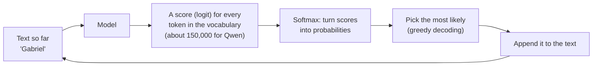
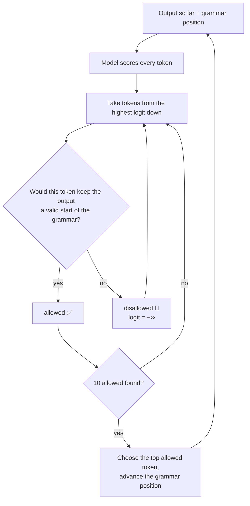
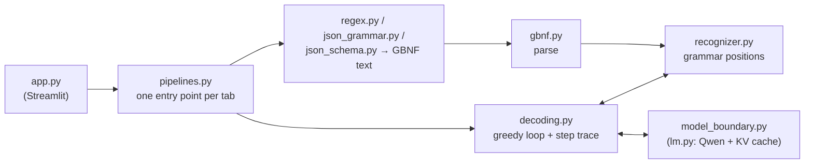

# How Grammar Constraints Work: a Beginner's Guide

This guide explains **grammar-constrained decoding** from the ground up and walks through every
tab of the Grammar-Constrained Explorer. No machine-learning background is needed. If a word is
unfamiliar, check the [glossary](../GLOSSARY.md).

> **The 30-second version.** A language model writes one small piece of text (a *token*) at a time,
> after scoring every possible token. A **grammar** is a set of rules saying exactly which strings
> are valid output. **Grammar-constrained decoding** checks, before each choice, which tokens
> would still leave the output a valid start of the grammar. Every other token's score is set to
> −∞ (it is *masked*), so the model can only write text the grammar allows. That's **logits
> masking**, with the grammar deciding what to mask. JSON mode, regex constraints and structured
> output all work this way.

All examples below are real outputs of the app with `Qwen/Qwen2.5-0.5B-Instruct` and the
presets as shipped. Decoding is greedy, so you'll see the same results when you click.

---

## 1. How a language model picks the next token

A language model runs a loop:



- A **token** is a chunk of text: often a word with its leading space (`␣García`), sometimes a
  piece of a word (`ár`), a digit, punctuation or a newline. The app shows spaces as `␣` and
  newlines as `⏎`, so you can tell `␣3` from `3`.
- **Logits** are the model's raw scores; **softmax** turns them into probabilities that add up to
  100%. A token with logit −∞ gets exactly 0%.
- The model stops when it picks the special **end-of-sequence** token (`<|im_end|>` for Qwen), or
  when a token limit is reached.

If you can change the logits before the choice, you control what the model may write. The
companion app, logits-masking-explorer, does that with lists of banned phrases. This app does it
with a grammar.

---

## 2. Grammar-constrained decoding is logits masking

### The idea

At every step:

1. The model scores every token.
2. For each candidate token, ask the grammar: *if I append this token, is the output still the
   beginning of something the grammar allows?* If yes, the token is **allowed**; if no, it is
   **disallowed**.
3. Disallowed tokens get logit −∞. The remaining probabilities are renormalised.
4. The most likely allowed token is chosen.



One more rule matters a lot: **end-of-sequence is allowed only when the output fully matches the
root rule.** Until then the model *cannot* stop, however much it wants to. Section 3 shows what
that leads to.

### Side by side with phrase-list masking

| | Phrase-list masking (logits-masking-explorer) | Grammar-constrained decoding (this app) |
|---|---|---|
| What decides the mask | A list of banned phrases | A grammar |
| Default for a token | Allowed, unless it finishes a banned phrase | Disallowed, unless the grammar allows it |
| How much is masked | A handful of tokens | Often almost the whole vocabulary |
| What you get | Output that avoids some phrases | Output that matches a format exactly |
| The term used | *banned* token | *disallowed* token |

The mechanism is the same: logits set to −∞ before the token is chosen. The difference is which
side the default is on. In the app, the **Exact count** button in the step trace checks the whole
vocabulary at one step. At the first step of the *Total apples* question it reports 18,416 tokens
allowed and 133,520 disallowed (88% of the vocabulary ruled out), because the output has to start
with a lowercase name, a digit or `(`. The model's favourite, `To` (48%), is one of the 🚫.

---

## 3. Grammars (tab ①)

### What a grammar looks like

The app uses **GBNF**, the grammar format of llama.cpp and transformers-cfg. Here is the book-record
grammar from notebook 1:

```
record ::= author separator title separator year
author ::= [a-zA-Z ]* | unk
title ::= [a-zA-Z ]* | unk
year ::= [1-2][0-9][0-9][0-9] | unk
unk ::= "NULL"
separator ::= "|"
```

- Each line is a **rule**: a name, `::=`, and what it matches.
- `"NULL"` and `"|"` are **literals**: exactly those characters.
- `[a-zA-Z ]` is a **character class**: one character from the set (letters and space). `*` means
  "zero or more", `+` "one or more", `?` "optional", and `|` separates alternatives.
- The **root rule** (here `record`) is what the whole output must match. You can choose another
  root rule in the app to constrain the output to just that part.

### The grammar position

To check a token, the app keeps track of where the output is within the grammar: the **grammar
position**. The step trace shows it as *Open rules* (rules the output has started but not
finished) and *May come next* (the characters that would be allowed next, plus "end of output"
once the root rule is fully matched).

For example, after `Gabriel Garcia` the trace shows:

- **Open rules:** `record › author` (the author may go on) · `record › separator` (or the author
  is finished and the separator comes next). The recognizer keeps every possibility open until
  the text decides between them.
- **May come next:** `[a-zA-Z ]` or `"|"`.

A rule can drop out of *Open rules* before it is finished: once the output has entered its last
element and that element is another rule (a tail call), only that rule is kept open. That's how a
repeat such as `[a-zA-Z ]+` stays one open rule instead of nesting one level deeper per letter.

An `í` can't come next, so any token containing one is disallowed.

### A real example: accents stripped (book record, *Cholera*)

| | Output |
|---|---|
| Unconstrained | `Gabriel García Márquez \| El amor en los tiempos del cólera \| 1985` |
| Grammar-constrained | `Gabriel Garcia Marez \| El amor en los tiempos del cholera \|1985` |

The step trace shows exactly where the content changed:

| Step | Model's favourite | Allowed? | Chosen instead |
|---|---|---|---|
| 2 | `␣García` (99.7%) | 🚫 `í` is not in `[a-zA-Z ]` | `␣Garcia` (0.2%) |
| 4 | `ár` (100%) | 🚫 `á` is not in `[a-zA-Z ]` | `arez` |
| 14 | `␣có` (99%) | 🚫 | `␣chol` |
| 17 | `␣` (99.4%) | 🚫 the grammar has no space before the year | `1` |

The notebook's Phi-3 got "Garcia Marquez". Qwen does worse: once `ár` is disallowed, the best
allowed token is `arez`, and the name is now wrong, not just unaccented. **A grammar that
validates the format can quietly change the content.** Notice also step 17: the separator is a bare
`|`, and the space before it belongs to the title's `[a-zA-Z ]*`, so no space is possible before
the year.

On *Tirukkural* the year isn't given as a single number, and the model writes `NULL` (`Valluvar |
Tirukkural |NULL`): the grammar offers it as the only non-number way to fill `year`.

### A grammar that's too strict (arithmetic, *More apples than oranges?*)

The arithmetic grammar only allows equations, `expr = term`:

```
root  ::= line ("\n" line)*
line  ::= expr "=" ws term
expr  ::= term ([-+*/] term)*
term  ::= ident | num | "(" ws expr ")" ws
ident ::= [a-z] [a-z0-9_]* ws
num   ::= [0-9]+ ws
ws    ::= [ \t\n]*
```

For *Total apples* that's fine: the constrained output is `3 +2 = 5`, then end-of-sequence.

But "Do Bill and Mae have more apples than oranges?" needs a comparison such as `3 + 2 > 2 + 4`,
and `>` isn't in the grammar. The constrained output is `2 +3 -2 -4 = 1⏎⏎1 = 1`: ✅ complete,
perfectly valid, and meaningless. The grammar can't make the model answer the question; it can
only stop it from writing anything outside the grammar.

### The model can't stop (the notebook's grammar)

The notebook's version of the grammar ends every line with a newline:
`root ::= (expr "=" ws term "\n")+`. The app keeps it as the preset *Arithmetic expression
(notebook grammar: newline after every line)*. Run *Total apples* with it and open step 6:

| Token | Before the mask | Allowed? |
|---|---|---|
| `<|im_end|>` (end-of-sequence) | 83.1% | 🚫 the output `3 +2 = 5` doesn't match the root rule yet: it needs `⏎` |
| `⏎⏎` | 9.3% | ✅ ← chosen |
| `␣total` | 4.2% | 🚫 |

The model wanted to stop, but end-of-sequence was disallowed until the newline was written. After
`⏎⏎` the model has lost its moment: it writes `total`, then more equations, and keeps going until
the token limit (⚠️ incomplete output). *More apples than oranges?* loops the same way
(`2 +3 -2 -4 = 1⏎⏎1 = 1⏎⏎1 = 1…`), as it does in the notebook. That's why the app's default
preset puts the newline *between* lines instead.

---

## 4. A regex constraint is a grammar (tab ②)

Outlines, the library in notebook 1's second example, constrains output with a regular expression:

```
([a-zA-Z ]+|NULL) \| ([a-zA-Z ]+|NULL) \| ([1-2][0-9][0-9][0-9]|NULL)
```

The app converts it into a grammar with one rule, and shows you the result:

```
root ::= ([a-zA-Z ]+ | "NULL") " | " ([a-zA-Z ]+ | "NULL") " | " ([1-2] [0-9] [0-9] [0-9] | "NULL")
```

Then it decodes with exactly the same engine as tab ①. The whole output must match the regex,
as if it had `^…$` around it. So the regex supports no anchors (they would mean nothing),
lookarounds or backreferences, which a grammar can't express this way.

The real outputs show that small differences in a grammar change the content:

| Input | Tab ① (GBNF) | Tab ② (regex) |
|---|---|---|
| *Cholera* | `… del cholera \|1985` | `… del cholera \| 1985` |
| *Tirukkural* | `Valluvar \| Tirukkural \|NULL` | `Valluvar \| Tirukkural \| 2000` |

Why `2000`? The regex puts a space after `|`, and Qwen happily writes it (step 10: `␣` at 96%,
allowed here, while tab ①'s grammar disallowed it and pushed the model to `NULL`). At step 11 the
model wants `5` (51%, as in "5th century") or `4` (37%, as in "450"). Both are 🚫, because the
year must start with `1` or `2`. The best allowed token is `2` (2.5%), and the model completes it
as `2000`, a year that isn't in the text. Once the model has started down a path, the constraint
only decides which wrong answer it ends up with. A tiny difference between two grammars (one
space) changed the answer from `NULL` to a made-up year.

---

## 5. JSON mode (tab ③)

### The idea

OpenAI's JSON mode (notebook 2a) promises that the output parses as JSON. That is a grammar too,
one that allows **any** JSON object:

```
root   ::= object
value  ::= object | array | string | number | ("true" | "false" | "null") ws
object ::= "{" ws (member ("," ws member)*)? "}" ws
member ::= string ":" ws value
array  ::= "[" ws (value ("," ws value)*)? "]" ws
string ::= "\"" char* "\"" ws
...
```

Look at `member ::= string ":" ws value`: **any** string can be a key, and **any** value can
follow it. The grammar guarantees JSON, not *your* JSON.

### Real examples

- The unconstrained run wraps its answer in a ```` ```json ```` fence. In the constrained run,
  step 0 shows the backtick token 🚫: only `{` can start the output.
- Accents survive (`"Gabriel García Márquez"`), because a JSON string allows any character.
- **Value types aren't controlled.** On *Tirukkural*, Qwen writes `"year": "450-500 CE"`: a
  string, where a number (or `null`) was meant. GPT-4o-mini in the notebook wrote `"year": "NULL"`,
  the same kind of slip.
- **Keys aren't controlled.** The notebook's prompt names the keys, and Qwen follows it. The
  preset *Book record as JSON, keys not named* drops the key names from the prompt, and the model
  writes `"publication_year"` instead of `"year"`. Only the prompt was choosing the keys.

### Whitespace and the whitespace loop

JSON allows whitespace between any two tokens, so the plain grammar has `ws ::= [ \t\n]*`:
unlimited spaces and newlines. That opens a trap. Suppose the model wants a token the grammar
disallows, and the most likely token that's still allowed is whitespace. It writes a space or
newline. At the next step the situation is the same, so it writes another. Nothing in the grammar
forces it to move on, and the output fills up with whitespace until the token limit: a
**whitespace loop**. (OpenAI's documentation warns about exactly this when the prompt doesn't ask
for JSON.)

With **Limit whitespace** on, the app uses this rule instead:

```
ws     ::= (" " | "\n" indent)?
indent ::= [ \t]? [ \t]? ... (12 times)
```

At most one space, or one newline plus up to 12 spaces of indent. The model can't loop for long:
once the whitespace is used up, it must write something else.

**An honest note.** In the smoke test of this app, Qwen 0.5B never fell into a whitespace loop in
JSON mode, with the limit on or off: on these presets it never strongly wanted a token that "any
JSON object" disallows. You'll see a real loop in tab ④, where a schema does the forcing.

---

## 6. Structured output (tab ④)

### The idea

Structured output (Gemini with pydantic-ai in notebook 2b) goes one step further: the output must
match a **schema**. The app takes the notebook's `Invoice` dataclass written as JSON Schema and
turns it into a grammar:

```
root ::= "{" ws
    "\"purpose\":" ws string "," ws
    "\"amount\":" ws number "," ws
    "\"currency\":" ws currency
    "}" ws
currency ::= ("\"USD\"" | "\"UKP\"" | "\"INR\"" | "\"EUR\"") ws
```

The keys are literals, in schema order, so the model only fills in the values. `amount` must be a
number. The **enum** `currency` becomes a choice between four literal strings: nothing else can be
written there.

### Why every field is required and in order

`currency` has a default (`USD`) in the notebook, so pydantic would let it be left out. The
grammar still requires it. A grammar either allows a key at a position or it doesn't. Writing
every field, in the order the schema lists them, gives one simple sequence of keys. Letting fields
be left out, or come in any order, would multiply the alternatives the grammar has to spell out.
Order also helps quality: the model writes `purpose` and `amount` first and can use them when
choosing `currency`.

### Real examples

| Input | Constrained output |
|---|---|
| *Taxi ($32.30)* | `{ "purpose": "Taxi-ride to airport", "amount": 32.30, "currency": "USD" }` |
| *Clients (€43)* | `{⏎  "purpose": "Entertaining clients",⏎  "amount": 43⏎            ,⏎  "currency": "EUR"⏎}` |
| *Dinner (₹820)* | `{⏎  "purpose": "Dinner",⏎  "amount": 820⏎            ,⏎  "currency": "INR"⏎}` |

The prompt never mentions currency: the model infers it from the input and the enum. In the step
trace of *Clients (€43)*, the model's favourite for `currency` includes `€` (29%), which is 🚫;
`EUR` (60%) is allowed.

### A real whitespace loop

Why the strange `43⏎            ,`? Open the step trace of *Clients (€43)*:

- After `43` the model writes `⏎`, then wants `}` at 99.9%: it thinks the invoice is finished.
  But `currency` is required, so `}` is 🚫.
- The most likely allowed token is a space. And again, and again: steps 19 to 30 write the 12
  spaces of indent the limited `ws` allows.
- At step 31 the model still wants a space (99%), but the indent is used up, so it's 🚫. The best
  allowed token is `,⏎`, and the model moves on to `"currency": "EUR"`.

Now turn **Limit whitespace** off and run it again: the output ends in newline after newline until
the token limit, ⚠️ incomplete output. That's the whitespace loop, caused by a required field the
model didn't want to write, and stopped by limiting whitespace.

---

## 7. How the app is built



- **Our own grammar engine** ([ADR 0001](adr/0001-own-grammar-engine.md)). transformers-cfg,
  Outlines and llguidance are much faster, but their internal state is hidden. The app needs to
  show the grammar position at every step, so it uses a small GBNF parser and a character-level
  recognizer written for this purpose.
- **Lazy checking.** The app doesn't check all 150,000 tokens at each step. It walks the tokens
  from the highest logit down and stops once 10 are allowed (the trace says "checked N tokens:
  M disallowed"). A first-character pre-filter rules out tokens whose first character can't come
  next without walking them through the grammar. The **Exact count** button does the full check
  for one step, so you can see how much of the vocabulary the grammar really rules out.
- **Bytes, not characters.** Qwen's tokens are bytes, and a token can hold half of a character
  (Tamil characters in the *Tirukkural* paragraph are split like this). The app checks tokens as
  bytes and only judges a character once all its bytes are in (`grammar_lab/utf8.py`).
- **One test seam.** Only `lm.py` touches torch. Everything else talks to a small interface
  (`model_boundary.py`), so the tests use a fake tokenizer and a fake model that "wants" chosen
  tokens, and check that the grammar wins.

### The four tabs side by side

| Tab | Constraint you write | Becomes | Controls | Doesn't control |
|---|---|---|---|---|
| ① | GBNF grammar | itself | Exactly what you wrote | Whether the content is right |
| ② | Regex | a one-rule grammar | The whole output's shape | Same as ① |
| ③ | (nothing: "JSON") | the JSON grammar | That the output parses as JSON | Keys, value types |
| ④ | JSON Schema | a grammar with the keys spelled out | Keys, order, types, enum values | Whether the values are right |

---

## 8. Where the app differs from the notebooks

- **Model.** Qwen2.5-0.5B-Instruct runs locally instead of Phi-3-mini (notebook 1), GPT-4o-mini
  (2a) and Gemini 1.5 Flash (2b), so outputs differ. The cloud APIs appear only as read-only
  snippets.
- **One engine for everything.** Notebook 1 uses transformers-cfg and Outlines; 2a and 2b use
  cloud features. The app turns all of them into a GBNF grammar and runs its own engine.
- **Preset adjustments for Qwen** (checked with the 0.5B model):
  - The default *Arithmetic expression* preset puts the newline between lines, so the model may
    stop right after `3 +2 = 5`. The notebook's grammar is kept as a second preset, where Qwen
    can't stop (section 3).
  - *Book record as JSON, keys not named* is new: Qwen follows the notebook prompt's key names,
    so the keys-not-controlled lesson needs a prompt that doesn't name them (section 5).
  - Tab ④ has its own **Limit whitespace** toggle, because that's where Qwen really loops
    (section 6). In JSON mode it didn't.
- **Different outputs, same lessons.** Qwen writes "Garcia Marez" where Phi-3 wrote "Garcia
  Marquez", uses the Spanish title for *Cholera*, and writes `"450-500 CE"` where GPT-4o-mini wrote
  `"NULL"`.
- **Prompts.** The app sends notebook 2a's `developer` message with role `system`, and formats
  every prompt with Qwen's chat template. The Outlines snippet adds the `return prompt` that the
  notebook's `convert_message_to_prompt` is missing.
- **Schemas instead of Python.** You edit the `Invoice` schema as JSON Schema; the app shows it
  as a read-only dataclass, and never runs Python you type.
- **Greedy only.** Like the notebooks' `do_sample=False`, there's no sampling or beam search.
